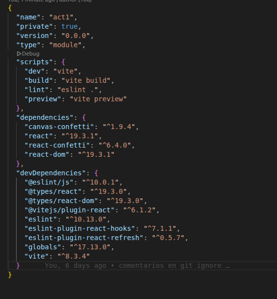

# actividad 

profe tu dijiste q 3 imagenes pero en la actividad pides 4 
## Si la carpeta node_modules/ está excluida, ¿borrar una dependencia hace alguna acción sobre el repositorio? ¿Cuál?
no, solo se elimina de node_modules pero no se modifica el respositorio.

